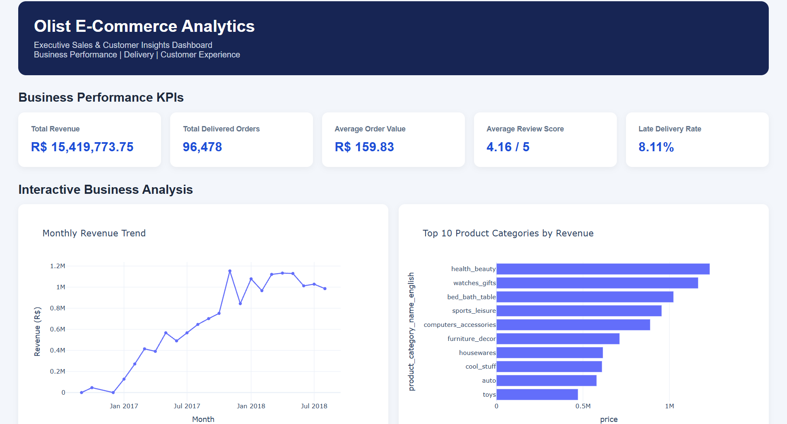

# 🛒 Brazilian E-Commerce Data Analytics Project (Olist)

An end-to-end data analytics project exploring the Brazilian E-Commerce Public Dataset by Olist. This project uses Python, SQL, data visualization, and machine learning to uncover business insights, analyze customer purchasing behavior, and identify opportunities for business growth.

---

## 📌 Project Overview

The goal of this project is to analyze e-commerce transactions, understand customer behavior, evaluate delivery performance, and discover patterns that can support better business decisions.

The analysis covers order trends, revenue, product categories, customer locations, payment methods, customer reviews, delivery performance, and customer segmentation.

## 🎯 Business Objectives

- Analyze overall e-commerce sales and revenue trends.
- Identify the best-performing product categories.
- Understand customer distribution across Brazilian states.
- Evaluate delivery performance and delays.
- Analyze customer reviews and payment preferences.
- Segment customers using RFM analysis and K-Means clustering.
- Develop actionable business recommendations.

## 📂 Dataset

**Dataset:** Brazilian E-Commerce Public Dataset by Olist

The dataset contains approximately 100,000 orders from 2016 to 2018 and includes nine CSV files:

| Dataset | Description |
|---|---|
| Customers | Customer information and locations |
| Geolocation | Brazilian geographical coordinates |
| Order Items | Products purchased in each order |
| Order Payments | Payment methods and installments |
| Order Reviews | Customer ratings and reviews |
| Orders | Order status and timestamps |
| Products | Product information |
| Sellers | Seller information |
| Category Translation | Portuguese-to-English category names |

**Dataset source:** [Olist Brazilian E-Commerce Dataset – Kaggle](https://www.kaggle.com/datasets/olistbr/brazilian-ecommerce)

Note: Raw dataset files are not included in this repository. Download the dataset from Kaggle and place the CSV files in the appropriate data folder.

## 🛠️ Technologies Used

| Technology | Purpose |
|---|---|
| Python | Data analysis and processing |
| Pandas | Data cleaning and manipulation |
| NumPy | Numerical operations |
| SQLite | Database management and SQL queries |
| SQL | Business data analysis |
| Matplotlib | Data visualization |
| Seaborn | Statistical visualization |
| Plotly | Interactive dashboard |
| Scikit-learn | Customer segmentation |
| K-Means | Clustering algorithm |
| StandardScaler | Feature scaling |
| Google Colab | Notebook execution |
| Git & GitHub | Version control |

## 🔄 Project Workflow

### Phase 1: Project Setup and Data Loading
- Created the project structure.
- Collected and organized the nine dataset files.
- Prepared the Python analysis environment.

### Phase 2: SQL Database and Analysis
- Created a SQLite database.
- Imported the datasets into database tables.
- Performed SQL-based business analysis.
- Used JOIN, GROUP BY, ORDER BY, aggregation, and filtering.

### Phase 3: Data Cleaning and Feature Engineering
- Handled missing values and duplicate records.
- Converted date columns into datetime format.
- Translated product categories into English.
- Created additional analytical features:
  - Delivery days
  - Late delivery indicator
  - Order month
  - Order weekday
  - Order hour
  - Total order value

### Phase 4: Exploratory Data Analysis (EDA)
Created visualizations to explore:
- Monthly revenue trends
- Top product categories
- Customer distribution by state
- Delivery time distribution
- Customer review distribution
- Late delivery and review relationship
- Order activity by weekday and hour
- Payment method distribution
- Product price versus freight value
- Numerical feature correlations

### Phase 5: Customer Segmentation
Applied RFM analysis and K-Means clustering to identify customer groups.

**RFM metrics:**
- Recency: How recently a customer purchased.
- Frequency: How often a customer purchased.
- Monetary: How much a customer spent.

Used StandardScaler for feature scaling and the Elbow Method and Silhouette Score to help select the number of clusters.

### Phase 6: Interactive Dashboard
Developed an interactive dashboard using Plotly.

**Dashboard KPIs:**
- Total Revenue
- Total Orders
- Average Order Value
- Average Review Score
- Late Delivery Percentage

**Dashboard visualizations:**
- Monthly revenue trend
- Top product categories
- Orders by customer state
- Delivery days distribution
- Customer review distribution
- Customer segment distribution

### Phase 7: Business Insights and Recommendations
- Extracted numerical business insights.
- Identified potential business improvement areas.
- Prepared recommendations related to customer experience, marketing, product strategy, regional growth, and payment preferences.

## 📊 Dashboard Preview



**Interactive Dashboard:** [View Dashboard HTML](dashboard/dashboard.html)

Download the repository and open `dashboard/dashboard.html` in a browser to explore the dashboard.

## 📈 Exploratory Data Analysis

The project includes visualizations covering revenue, categories, geographical distribution, delivery performance, reviews, payment methods, and customer behavior.

### Visualization Gallery

| Analysis | Visualization |
|---|---|
| Monthly Revenue | `chart_01_monthly_revenue.png` |
| Top Product Categories | `chart_02_top_categories.png` |
| Orders by State | `chart_03_top_states.png` |
| Delivery Distribution | `chart_04_delivery_distribution.png` |
| Review Distribution | `chart_05_review_distribution.png` |
| Late Delivery vs Review | `chart_06_late_vs_review.png` |
| Weekday and Hour Analysis | `chart_07_weekday_hour_heatmap.png` |
| Payment Distribution | `chart_08_payment_distribution.png` |
| Price vs Freight | `chart_09_price_vs_freight.png` |
| Correlation Heatmap | `chart_10_correlation_heatmap.png` |
| K-Means Elbow Method | `chart_11_elbow_method.png` |
| Customer Segmentation | `chart_12_customer_segments.png` |

## 💡 Business Recommendations

1. **Improve Customer Experience:** Monitor delivery delays and investigate factors affecting customer satisfaction.
2. **Targeted Marketing:** Use RFM segments to create personalized campaigns and improve customer retention.
3. **Product Strategy:** Focus on high-performing product categories and identify opportunities for growth.
4. **Regional Growth:** Analyze state-wise order patterns to identify regions with growth potential.
5. **Payment Strategy:** Use payment preference analysis to improve the checkout experience.

## 📁 Project Structure

```text
olist-ecommerce-analytics/
│
├── data/
│   ├── raw/
│   └── processed/
│
├── notebooks/
│   └── Olist_Ecommerce_Analytics.ipynb
│
├── sql/
│   └── queries.sql
│
├── src/
│
├── images/
│   ├── dashboard_preview.png
│   ├── chart_01_monthly_revenue.png
│   ├── chart_02_top_categories.png
│   ├── chart_03_top_states.png
│   ├── chart_04_delivery_distribution.png
│   ├── chart_05_review_distribution.png
│   ├── chart_06_late_vs_review.png
│   ├── chart_07_weekday_hour_heatmap.png
│   ├── chart_08_payment_distribution.png
│   ├── chart_09_price_vs_freight.png
│   ├── chart_10_correlation_heatmap.png
│   ├── chart_11_elbow_method.png
│   └── chart_12_customer_segments.png
│
├── dashboard/
│   └── dashboard.html
│
├── README.md
├── requirements.txt
└── .gitignore
```

## ⚙️ Installation and Usage

### 1. Clone the repository

```bash
git clone https://github.com/arushicoder/olist-ecommerce-analytics.git
```

### 2. Navigate to the project directory

```bash
cd olist-ecommerce-analytics
```

### 3. Install dependencies

```bash
pip install -r requirements.txt
```

### 4. Download the dataset

Download the Brazilian E-Commerce Public Dataset from Kaggle and place the nine CSV files in the project's data directory.

### 5. Run the analysis

Open the Jupyter notebook in Google Colab or Jupyter Notebook and execute the cells in order.

### 6. View the dashboard

Open:

```text
dashboard/dashboard.html
```

in your web browser.

## 📌 Key Learning Outcomes

Through this project, I gained practical experience in:

- Data cleaning and preprocessing.
- SQL queries and relational database analysis.
- Exploratory Data Analysis.
- Data visualization and storytelling.
- Feature engineering.
- RFM analysis.
- Machine learning clustering.
- Interactive dashboard development.
- Business insight generation.

## 👩‍💻 Author

**Arushi**

- GitHub: [@arushicoder](https://github.com/arushicoder)
- LinkedIn: [Connect on LinkedIn](https://www.linkedin.com/in/ribani-biswas-79347838b/)

---

⭐ If you find this project useful, feel free to explore the repository and give it a star!

**Project:** Brazilian E-Commerce Analytics using the Olist Dataset

**Status:** Data analysis, visualization, customer segmentation, and dashboard development completed.